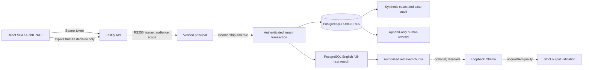

# Aegis AI — MVP completion and acceptance audit

**Audit date:** 2026-11-15

**Verified source:** `main` at `ae5fe85768912aed1df1cd77164c4373e8c4746b`

**Decision:** **AUTHENTICATED HUMAN-REVIEW MVP: ACCEPTED** for the local synthetic demonstration scope. This decision does not qualify grounded-AI output quality or production readiness.

## Executive summary

Aegis demonstrates an authenticated, tenant-scoped synthetic case workflow with persistent human review. A human operator completed real Auth0 browser sign-in, viewed a Synthetic North case, was denied Synthetic South access, and confirmed that reader restrictions and operator review controls behaved as expected. After one separately approved review, the operator confirmed the Defer entry remained visible after browser refresh. Read-only database verification confirmed one correctly attributed review, its PostgreSQL-generated timestamp, and an unchanged case status.

The live model-quality question is separate and unresolved. **GROUNDED AI LIVE QUALITY: NOT QUALIFIED.** AI remains disabled for routine local operation. Retrieval uses PostgreSQL English full-text search; the product does not use pgvector or claim production-grade multi-agent orchestration.

## Evidence provenance

| Class | Evidence and source | What it establishes | Limits |
|---|---|---|---|
| A — Real human browser | Operator-confirmed Auth0 login; North case visible; South denied; reader submission restriction; operator controls visible; Defer review persisted in history after refresh | The reviewed local browser journey worked for the signed-in development identity and synthetic tenants | No token was exposed or independently decoded. This is not a penetration test or production security certification |
| B — Database verification | Read-only administrator queries before/after the authorized review, compared with captured table fingerprints | Exactly one matching North review; decision/note and operator attribution matched; timestamp present and trigger-generated; status stayed `in_progress`; unrelated data fingerprints stayed unchanged | Database verification is limited to the local synthetic database and the observed point in time |
| C — Live API/runtime | Read-only health and runtime-role checks; API and Vite each returned HTTP 200; API was bound to loopback; migrations 001–006 matched source checksums | The activated local API and web app were reachable and the restricted runtime role passed its verifier | Does not establish availability under load or production operations |
| D — Automated tests and CI | [Main push CI run 43682896006](https://github.com/AnkurSingh16/aegis-ai-architect-portfolio/actions/runs/43682896006), successful on the verified main commit | Lint, typecheck, automated tests/coverage, mocked browser workflow, isolated PostgreSQL integration, build, whitespace, and Auth0 Terraform validation passed | Browser CI mocks identity and API responses. It is not the real Auth0 acceptance above |
| E — Source inspection | Auth, route, transaction, migration, RLS, review UI and lifecycle implementation | Documents intended enforcement, append-only review behavior, validation, and no-action boundaries | Source inspection alone is not runtime evidence |
| F — Not verified or deferred | Live model quality, production deployment, live HTTP response code for the review, and live idempotency replay | These remain explicit limitations | No inference, review replay, public deployment, or live penetration test was performed |

The UI reported review success, but the exact HTTP status was not captured. The database contains one new review. Idempotency is covered by implementation and automated tests; the live POST was not replayed. The review is the relevant persisted review evidence; no additional `audit_events` row was expected or observed.

## Acceptance matrix

| Capability | Status | Evidence and scope |
|---|---|---|
| Auth0 authentication | **VERIFIED** | Human operator completed real local browser login |
| North tenant authorization and case listing | **VERIFIED** | Human operator viewed the synthetic North case; backend requires signed scope and exact issuer/subject membership |
| South cross-tenant denial | **VERIFIED** | Human operator confirmed denial without South case disclosure; automated database integration also tests isolation |
| Read/write scope and reader/operator boundary | **VERIFIED** for the demonstrated workflow | Reader restrictions were observed; after the approved membership change, operator controls appeared. The UI consumes `X-Aegis-Can-Review`, which the API sets only when `write:cases` and operator membership both hold. No token was inspected or disclosed |
| Human-review submission | **VERIFIED** | One separately approved Defer decision was submitted through the authenticated UI and persisted once |
| Review history after refresh | **VERIFIED** | Human operator confirmed the persisted entry remained visible after refresh |
| Reviewer attribution and database timestamp | **VERIFIED** | Read-only row comparison matched the North operator membership; database trigger supplies actor and timestamp |
| Idempotency | **TESTED IN AUTOMATION ONLY** | Same-key behavior and conflict handling are covered by tests; no live replay was performed |
| Case-status preservation and no downstream action | **VERIFIED** for the observed review | Status remained `in_progress`; review code records a decision only and does not execute support actions |
| PostgreSQL RLS and restricted runtime role | **VERIFIED** for local synthetic scope | Runtime-role verifier passed; isolated PostgreSQL integration and live tenant-denial evidence passed. This is not an independent penetration test |
| Migration history | **VERIFIED** | Migrations 001–006 were present and recorded checksums matched repository SQL |
| CI and automated quality gates | **VERIFIED** | Successful run 43682896006 on the approved main commit; browser tests were mocked and database integration used isolated CI storage |
| Local deployment/reproducibility | **VERIFIED** for the observed local setup | Approved main, API/Vite health, runtime role, and demo runbook were checked. No cloud deployment is claimed |
| Grounded retrieval behavior | **TESTED IN AUTOMATION ONLY** | PostgreSQL English full-text retrieval, tenant controls and citation contracts have implementation and integration tests; no live model call was made in this acceptance |
| Grounded recommendation quality | **DEFERRED — NOT QUALIFIED** | Historical synthetic evaluations show contract/abstention limitations; no production accuracy or semantic-entailment claim is supported |
| Public hosting, React Native, vector search, production observability | **DEFERRED** | Not required for the accepted local portfolio MVP; revisit only against a demonstrated need and separate approval |

## Milestone reconciliation

The repository's roadmap has M1, M2A–M2D, M3A–M3B and M4, followed by later vertical slices. M5/M6 below are the portfolio's reporting labels for human review and operational/portfolio completion, not retroactive standalone acceptance specifications.

| Milestone | Status | Closure evidence or remaining boundary |
|---|---|---|
| M1 — Portfolio and synthetic triage | **VERIFIED** for the local synthetic portfolio | React portfolio and fixed synthetic triage are present; no customer data or business outcome is claimed |
| M2A — PostgreSQL cases and tenant RLS | **VERIFIED** for local synthetic data | Checksummed migrations, runtime-role checks, isolated integration and live North/South outcome |
| M2B — Auth0 identity and API authorization | **VERIFIED** for local browser acceptance | Real login, authorized North access, denied South access; token internals were not disclosed |
| M2C — Auth0 Terraform foundation | **TESTED IN AUTOMATION ONLY** | Credential-free Terraform validation passed in CI; no Terraform apply or cloud change is claimed |
| M2D — Protected browser case viewer | **VERIFIED** | Human-confirmed authenticated case-viewing workflow and tenant denial |
| M3A — Local AI case analysis | **DEFERRED** | Optional local provider exists but AI remains disabled; no new inference was run for this closure |
| M3B — Model evaluation and reliability | **TESTED IN AUTOMATION ONLY** as tooling; quality **NOT QUALIFIED** | Historical synthetic reports are diagnostic evidence only and do not establish model reliability |
| M4 — Grounded retrieval and analysis | Retrieval **TESTED IN AUTOMATION ONLY**; live quality **DEFERRED** | PostgreSQL FTS and request-scoped citation controls exist; citation identity does not prove semantic entailment |
| M5 — Human case review | **VERIFIED** | One authorized synthetic decision persisted with actor and timestamp and remained visible after refresh |
| M6 — Operational and portfolio readiness | **VERIFIED** for local demo scope | CI, lifecycle implementation, live local health and documentation support the local synthetic demonstration; public deployment is deferred |

## Architecture and boundaries

The tenant selector requests a resource; it is not an authorization boundary. The API checks signed scopes and exact issuer/subject membership in a transaction, while PostgreSQL RLS constrains tenant rows. The `aegis_app` runtime role is restricted and cannot rewrite review history. Human review is separate from case status and downstream support actions.

Retrieval is PostgreSQL English full-text search (`tsvector`/GIN), not vector search. Citation identity shows that a source ID belongs to the request's retrieved set; it does not prove that the cited text entails a recommendation. The model output remains advisory and requires human review. No live quality claim is made.

## Remaining limitations and next scope

- **GROUNDED AI LIVE QUALITY: NOT QUALIFIED.** Historical small synthetic samples do not establish production accuracy, natural supported-decision quality, or causal improvement.
- No live model inference was performed for MVP sign-off. Any future run needs separate authorization, a versioned report, reviewed source, and predeclared acceptance/rejection criteria.
- Automated browser tests use mocked Auth0/API behavior. Real Auth0 evidence is separately operator-confirmed above.
- No live idempotency replay or direct capture of the review HTTP status was performed.
- The project is a local synthetic architecture demonstration, not a production service, customer deployment, security certification, or measured business outcome.
- Cloud hosting, public API exposure, React Native, vector retrieval, additional models, and production observability are deferred unless a concrete need justifies them.

See the [dated acceptance evidence](MVP-ACCEPTANCE-2026-11-15.md), [portfolio case study](PORTFOLIO-CASE-STUDY.md), [local demo runbook](LOCAL-DEMO-RUNBOOK.md), and [security runbook](SECURITY-RUNBOOK.md).
