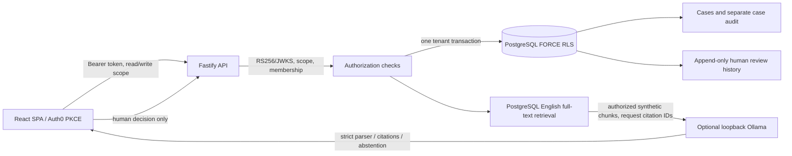
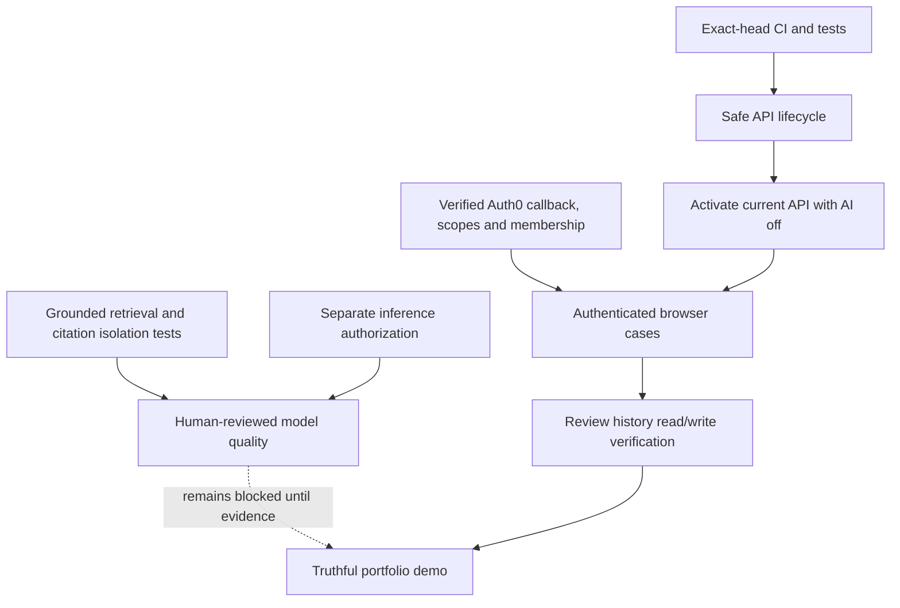

# Aegis AI — MVP completion audit

## Baseline and evidence

Audit baseline: `main` at `2c57af83d5563e821743f0902808e9d9a22edb40`, clean and synchronized with `origin/main` when this audit began. The latest main CI run observed was [43567849483](https://github.com/AnkurSingh16/aegis-ai-architect-portfolio/actions/runs/43567849483), successful on that exact commit. It passed lint, typecheck, automated tests/coverage, isolated PostgreSQL integration, build, whitespace and Auth0 Terraform validation. That run predates the current lifecycle/E2E changes and is not evidence for them.

The local database reports migrations 001–006 with repository-matching checksums. The approved API source initializes in-process, passes its runtime-role readiness check, registers both review routes, returns 401 for an unauthenticated review-history request, and closes its pool through `app.close()`. The existing API is a separately supervised process without a graceful signal handler and has not been replaced. The current browser login and review workflow have not been exercised with a real Auth0 session.

## Capability matrix

| Capability | Current state | Evidence | Missing work | Risk | Priority | Acceptance test |
|---|---|---|---|---|---|---|
| M1 — Portfolio and synthetic triage | IMPLEMENTED BUT UNVERIFIED | React portfolio and fixed synthetic triage; component/API tests | Reconciled portfolio claims and browser suite | Stale overview previously described only the starter | P1 | Playwright verifies portfolio loads and labels triage as synthetic |
| M2A — PostgreSQL cases and tenant RLS | VERIFIED COMPLETE | Migrations 001–006 checksum-verified; local rollout; isolated CI integration and role checks | None for the defined local synthetic scope | Local persistent database must not be treated as disposable | P0 | Isolated integration proves tenant denial and forced RLS |
| M2B — Auth0 API identity and authorization | IMPLEMENTED BUT UNVERIFIED | RS256/JWKS, issuer/audience/time/scope checks; transaction membership and RLS; generated-key and PostgreSQL tests | Real Auth0 login/token and actual tenant membership acceptance | Auth0 configuration or user membership can drift | P0 | Operator completes PKCE login; authorized list succeeds; invalid token/scope/cross-tenant fail |
| M2C — Auth0 Terraform foundation | VERIFIED COMPLETE for read-only foundation | Credential-free Terraform validation in CI; reviewed constrained Auth0 resources and state gates | No live apply is required for local MVP; confirm the configured callback against current operator-owned Auth0 state | Provider drift and identity changes require operator review | P2 | Terraform fmt/init/validate in CI; read-only state/origin check before login |
| M2D — Protected browser case viewer | IMPLEMENTED BUT UNVERIFIED | React SDK PKCE/memory cache; API proxy; component tests | Real browser sign-in and case-list test | Browser config/membership may not match API | P0 | Real operator session loads only its authorized synthetic tenant |
| M3A — Local case analysis | IMPLEMENTED BUT UNVERIFIED | Optional loopback Ollama provider, strict parser, tests; feature flags default off | Reliable accepted-output evidence and human-reviewed quality | Prior quality evidence is weak; model output can be wrong | P2 / approval-gated | Separately authorized evaluation passes predeclared quality gates; otherwise keep disabled |
| M3B — Model evaluation/reliability | VERIFIED COMPLETE as a bounded diagnostic framework; model quality unresolved | Frozen reports and deterministic scorers; historical 3B priority agreement 2/6 | No more prompt experiments absent a specific approved hypothesis | Small synthetic samples do not establish accuracy | P3 | Preserve report provenance; acceptance requires independent review and a new authorization |
| M4 — Grounded retrieval and analysis | IMPLEMENTED BUT UNVERIFIED | Synthetic catalog, restricted ingestion, tenant RLS, PostgreSQL English FTS, request-scoped citations, parser and abstention tests; no pgvector | Authenticated retrieval demonstration and acceptable independently reviewed model behavior | Citation identity is not semantic entailment; prior reports show over-abstention/contract failures | P1 for truthful demo; model use blocked | CI proves isolation; future authorized run separately evaluates groundedness and abstention |
| M5 — Human case review | IMPLEMENTED BUT UNVERIFIED | PR #64 merged; migration 006 applied/checksummed; actor trigger, append-only permissions, idempotency, integration/component tests; in-process readiness and route check | Safely activate current API; real Auth0 operator access; browser persistence/history verification | Current supervised API may be older source; review is a persistent write | P0 | Approved API replacement, then operator signs in and reviews synthetic case with persisted actor/time/history |
| M6 — Portfolio operations, browser automation and release readiness | INCOMPLETE | CI and Terraform validation exist; lifecycle/E2E work is in this branch | Run updated CI; add sanitized screenshots; complete runbook and manual acceptance | Green old CI and component tests are not live acceptance | P1 | Exact-head CI plus operator-run local acceptance checklist |
| Public cloud hosting / production service | INTENTIONALLY DEFERRED | Terraform templates and decisions exist; no approved deployment | Separate privacy, threat, cost, operations and deployment approval | Public exposure and ongoing cost | P3 | No work until separately authorized |
| React Native / multi-agent runtime / vector database | INTENTIONALLY DEFERRED | Future roadmap mentions them; current local MVP has no demonstrated need | None for local portfolio acceptance | Scope expansion without validated gap | P3 | Reopen only against a concrete user need and measured limitation |

### Roadmap reconciliation

The repository defines M1/starter, M2A–2D, M3A–3B, M4, and two later “vertical slices.” It does **not** define normative standalone M5/M6 acceptance documents. For this closure audit, M5 means the merged human-review slice and M6 means operational/portfolio hardening; that mapping is a reporting convenience, not a retroactive product requirement. The older roadmap's “approved actions” wording must not be read as permission to execute external actions: the current human-review feature records a decision only.

## Architecture and dependency path

Critical acceptance dependencies:

## Confirmed gaps and approval boundaries

- The old live API process cannot gain new signal handlers after startup. The code change in this branch improves future API processes only. Replacing the existing Codex-supervised API remains blocked until its stop mechanism is established and separately approved.
- Auth0 browser sign-in, North `operator` membership, `write:cases` scope, and cross-tenant denial have source and isolated-test coverage, but the real browser workflow is unverified. Do not grant membership or change Auth0 configuration as part of this work.
- Human review writes to persistent `aegis_local`; no live review submission is authorized by this audit.
- Historical reports are private evidence. Their summarized results show strong structural limitations: M4.15 and M4.18 each accepted 5/6 contracts and had 0/3 supported coverage with Billing 301 invalid confidence; M4.17 accepted 6/6 contracts but all outputs abstained and supported coverage remained 0/3. M4.22 forced-SUPPORTED diagnostic is not evidence of natural decision quality and has not been executed under the latest context.
- Retrieval is PostgreSQL English full-text search with `tsvector`/GIN. No vector index or pgvector retrieval is part of the current implementation.
- Automated browser tests added in this change use an isolated test Vite config, mocked identity and intercepted synthetic API responses. They test UI wiring, not Auth0, PostgreSQL RLS, real retrieval or model behavior; backend integration tests cover their own boundaries.

## Acceptance / rejection criteria for final local MVP

Accept only when: exact-head CI passes; the new lifecycle tests pass; the current API is safely activated with both AI flags false; real Auth0 login and authorized case list succeed; unauthorized/cross-tenant/read-only paths fail closed; human review persists the verified actor and database timestamp with history; no case status or downstream action changes; and the UI remains reachable.

Reject or keep blocked if: startup role verification fails; another listener would be displaced; Auth0 scope or membership is missing; a tenant boundary leaks; review history can be altered by the runtime role; any review write is duplicated or misattributed; AI is enabled unintentionally; or a mock result is represented as a live grounded recommendation.

No current evidence supports a production-accuracy claim or a public deployment. The intended deliverable is a local, synthetic, human-governed portfolio demonstration.
