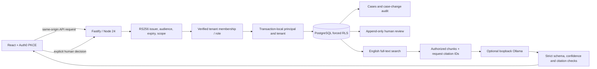
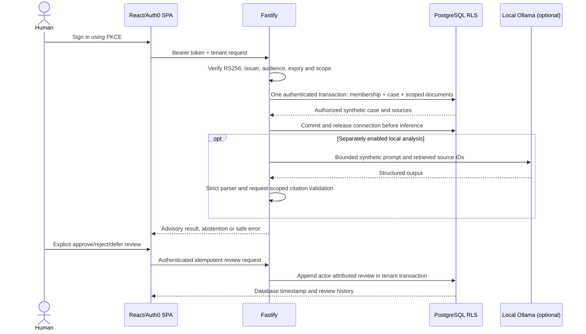

# Aegis AI — portfolio case study and demo

## Recruiter summary

Aegis is a local-first, synthetic support-case platform that demonstrates how identity, tenant authorization, PostgreSQL row-level security, retrieval, strict model-output validation and human review fit together. It favors an inspectable PostgreSQL full-text baseline and a local-only optional model over early cloud or vector-search complexity. Model quality and real Auth0 browser acceptance remain explicitly unverified.

## Two-to-three-minute demonstration script

1. **Frame the problem (20 sec):** “This is a synthetic support workflow. The engineering problem is allowing an operator to inspect only an authorized tenant’s case while keeping retrieval, model output and review decisions independently controlled.”
2. **Show the portfolio and health (20 sec):** open the local React app, show the API connectivity badge, and point out fixed mock triage is labeled synthetic rather than AI.
3. **Authenticate (30 sec):** operator completes Auth0 PKCE login/MFA. Do not display tokens. Show the requested tenant selector is not authorization.
4. **Show the case and evidence (30 sec):** open an authorized synthetic case. Explain retrieval uses tenant-scoped PostgreSQL English full-text search; opaque citations identify retrieved chunks but do not prove entailment.
5. **Show analysis honestly (20 sec):** only if a separately approved live run has passed its quality gates. Otherwise show the disabled or insufficient-evidence state and state that model quality is not qualified.
6. **Show human review (35 sec):** operator explicitly chooses approve/reject/defer, reviews the confirmation copy, and inspects actor-attributed history. Do not submit a decision in a public recording unless the synthetic write is separately authorized.
7. **Close with controls (20 sec):** explain forced RLS, strict output validation, no automatic case status changes/actions, CI integration tests, and what remains blocked.

## System architecture

## Data and request flow

## Security and engineering decisions

- The UI tenant selector selects a requested resource, not an authorization boundary. API JWT/scope validation, database membership, and forced RLS must all permit access.
- The runtime role is not the administrator or ingestion role. Migration checksums are immutable and integration tests use isolated PostgreSQL in GitHub Actions.
- Case-change audit and human-review records are separate. Review actor identity comes from the verified JWT context and the database trigger; runtime privileges cannot update/delete review rows.
- Retrieval is PostgreSQL English full-text search (`tsvector`/GIN), not pgvector or embedding search. Citation identity proves only that an ID came from the current request's retrieved set.
- Ollama is loopback-only, optional, bounded and disabled by default. Historical reports show output-contract failures and zero accepted supported coverage in the reported M4.15/M4.17/M4.18 samples. The forced-branch M4.22 diagnostic, if later run, would not qualify natural decisions.
- Human review records a decision; it does not execute an action, approve truth, or change case status.

## Current limitations and evidence

- Real Auth0 browser login, authorized North operator access and cross-tenant browser denial remain pending manual verification.
- The live API process has a known lifecycle-management blocker until it can be stopped gracefully under its supervisor. Current source lifecycle tests do not retrofit the already-running process.
- Model groundedness, supported-decision quality and production accuracy are not established.
- Static public hosting is acceptable for the portfolio. Public API/database hosting, AWS deployment, React Native, vector retrieval, additional models and production observability are deferred until a measured need and separate approval exist.

## Screenshot/capture plan

Capture only synthetic data in a local browser. Hide the browser address bar if it reveals sensitive local paths, redact Auth0 issuer/client values where desired, never show tokens/cookies/devtools storage, and do not capture `.env` files, raw model prompts/responses, or private report contents. Suggested frames: portfolio overview, case viewer with status badge, safe abstention/disabled state, and review-history UI with synthetic identity labels.

## Engineering interview case study

**Problem:** A small model and a simplistic authenticated UI can appear convincing while leaking cross-tenant content or encouraging unreviewed actions.

**Approach:** Build the data boundary first: issuer-derived JWT verification and scopes, tenant membership, transaction-local context and forced RLS. Add a source-controlled synthetic corpus and PostgreSQL FTS retrieval with explicit request-scoped citation IDs. Treat model output as untrusted; schema, taxonomy, confidence, rationale and citation membership are validated server-side. Keep optional local inference disabled by default. Finally, persist human review separately from case state with database-attributed identity and append-only privileges.

**Trade-offs:** PostgreSQL FTS is easier to inspect and isolate than adding vector infrastructure; it may have lower semantic recall. A small local model avoids cloud data egress but has limited quality, and historical tests show that schema compliance does not imply correct supported decisions. Manual Auth0 and local service setup limits unattended demos but avoids silently mutating identity or persistent data.

**Evidence:** Main CI run 43567849483 passed the seven existing gates on the approved baseline; backend PostgreSQL integration tests run against disposable CI storage. Current-source in-process readiness, runtime-role verification, route registration, unauthenticated rejection and pool close were observed. These are not the same as real browser login or an authorized live review write.

**Outcome:** The platform is a credible security/reliability portfolio implementation, but the local end-to-end acceptance remains blocked on safe API activation and operator-authenticated browser verification. The grounded AI quality claim remains deliberately limited.
