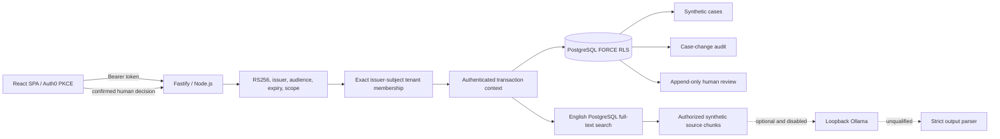
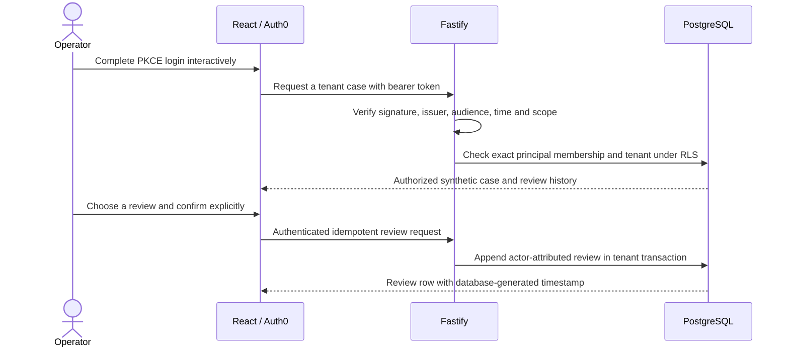

# Aegis AI — enterprise architecture case study

## Recruiter summary

Aegis is a local-first portfolio demonstration of an authenticated, multi-tenant support-case workflow. It combines Auth0 identity, PostgreSQL row-level security, synthetic case data, evidence retrieval, strict AI-output validation, and append-only human review. The completed local workflow has been exercised with a real Auth0 browser session and one separately authorized synthetic review. Grounded model quality remains **not qualified**, so AI stays disabled by default. This is not a customer-facing or production service.

## The engineering problem

An AI-assisted support interface creates several coupled risks: a tenant selector can be mistaken for authorization, untrusted model output can look authoritative, evidence references can be mistaken for proof, and an approval control can accidentally trigger an operational action. The design separates identity, data access, model validation, and human decision recording so each boundary can be inspected and tested.

## System architecture

### Request and data flow

The optional analysis path is not part of the accepted live workflow. Where enabled in a separately authorized development evaluation, retrieval and validation are performed before an advisory result is shown; they do not authorize actions or modify case state.

## Identity, tenant boundaries, and review

- The SPA uses the Auth0 React SDK with Authorization Code + PKCE and an in-memory token cache. The API verifies RS256 JWTs, issuer, audience, expiry, and required scopes.
- Authorization is the conjunction of signed permission scope and a server-managed `(issuer, subject, tenant, role)` membership. The requested tenant ID is not trusted as authorization.
- PostgreSQL uses explicit migrations, a restricted `aegis_app` runtime role, transaction-local principal/tenant context, and FORCE RLS. Local integration tests exercise the restricted role and cross-tenant paths.
- `reader` membership permits authorized reads; `operator` is required for review writes. The API/UI capability signal requires both operator membership and `write:cases`.
- Human reviews are separate append-only records. The database trigger attributes the verified actor and generates the timestamp. Idempotency prevents duplicate rows for a repeated key; a conflicting reuse is rejected.
- A review records a human decision only. It does not claim that an AI recommendation is correct, change case status, send a message, or execute a support action.

## Retrieval and AI boundaries

The implemented retrieval baseline is PostgreSQL English full-text search using `tsvector`/GIN and tenant-scoped synthetic documents. It is not pgvector, embedding search, or a vector database. Citation IDs are request-scoped and validated against the retrieved set. That proves citation identity, not semantic entailment.

The optional provider is local Ollama behind explicit development-only feature flags and bounded request settings. Output is parsed against strict contracts; insufficient evidence and invalid output remain visible failures. Historical synthetic runs exposed confidence/contract failures and over-abstention. They do not establish production accuracy. No production-grade multi-agent orchestration is claimed.

## Acceptance evidence and provenance

The local human-review MVP is accepted within its synthetic scope. The [dated acceptance record](MVP-ACCEPTANCE-2026-11-15.md) distinguishes:

- **Human-confirmed browser evidence:** real Auth0 login, North case visibility, South denial, reader restriction, operator controls, and the persisted review remaining visible after refresh.
- **Read-only database evidence:** exactly one matching review row, approved decision and note, actor matching the verified North operator membership, database-generated timestamp, unchanged `in_progress` case status, and unchanged unrelated data fingerprints.
- **Live runtime evidence:** API and Vite returned HTTP 200, the runtime-role verifier passed, and migrations 001–006 matched repository checksums.
- **Automation evidence:** main CI run [43682896006](https://github.com/AnkurSingh16/aegis-ai-architect-portfolio/actions/runs/43682896006) passed. Its browser suite uses mocked identity and API; PostgreSQL integration uses isolated CI storage.
- **Source evidence:** route, RLS, trigger, authorization, idempotency, lifecycle, and no-action boundaries were inspected. Source inspection is not a substitute for live acceptance.

The operator UI reported success, but the exact HTTP response code was not captured. Idempotency is covered by automated tests; the live request was not replayed. The review row is the relevant review evidence; no additional case `audit_events` record was expected.

## Architecture decisions and leadership trade-offs

1. **Establish the data boundary before adding model complexity.** Exact principal membership and database RLS are independent checks. The browser's tenant picker cannot grant access.
2. **Use inspectable SQL and PostgreSQL FTS for this scope.** It keeps tenant filters, indexes, grants, and migrations visible without introducing an unneeded vector service. The trade-off is that lexical retrieval may miss semantically related documents.
3. **Treat model output as untrusted.** Schema validation, citation membership, confidence checks, bounded errors, and mandatory human review remain server-side. A valid structure is not proof of a correct decision.
4. **Record decisions separately from actions.** Human review is append-only and actor-attributed; case status and external support actions remain untouched.
5. **Prefer reversible local operations and explicit gates.** The development database is persistent, so migrations, review writes, Auth0 changes, and inference each require separate authorization. CI integrations use disposable storage.
6. **Keep quality claims tied to evidence.** Mock browser tests support UI wiring; live operator acceptance supports the specific local journey; neither establishes production security or AI accuracy.

## Demonstration script (2–3 minutes)

1. Introduce the synthetic support-case problem and state that Aegis is a local architecture demonstration.
2. Show the portfolio and local API connectivity; distinguish fixed synthetic triage from LLM output.
3. Complete Auth0 login interactively without showing credentials, tokens, browser storage, or developer tools.
4. Show the authorized North case, then the expected South denial. Explain that selection is not authorization.
5. Show the human-review section and persisted Defer history. Explain that the reviewed decision does not change status or execute an action.
6. State that grounded AI uses PostgreSQL full-text retrieval and strict validation, but live model quality is not qualified and AI remains disabled for routine demos.
7. Close with the tenant/RLS boundary, CI evidence, and deferred production work.

Do not submit another review for a recording. Use only the existing synthetic history and sanitize the screen so no credentials or private configuration appear.

## Limitations and deferred extensions

- **GROUNDED AI LIVE QUALITY: NOT QUALIFIED.** No claim of reliable recommendations, real-world accuracy, or causal improvement is supported.
- The six-case synthetic evidence and historical runs are too small and not independent ground truth.
- No live idempotency replay, load test, independent penetration test, or production operations certification is claimed.
- Public API/database hosting, AWS deployment, React Native, vector retrieval, additional models, and production observability are deferred until a measured need and separate security/operational approval.
- No customers, actual customer data, business outcomes, adoption, cost savings, or performance benchmarks are represented.

For reproducible setup, ownership checks, and shutdown guidance, see the [local demo runbook](LOCAL-DEMO-RUNBOOK.md) and [security runbook](SECURITY-RUNBOOK.md).
